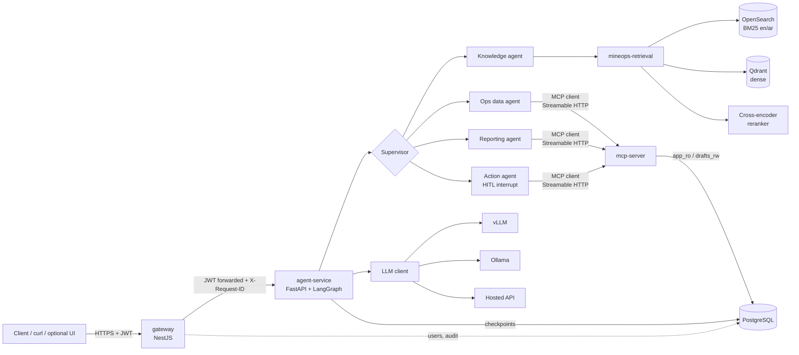
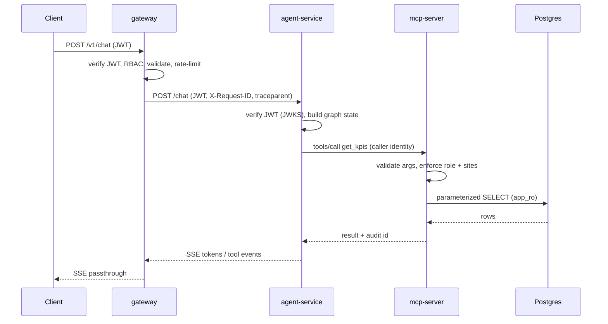
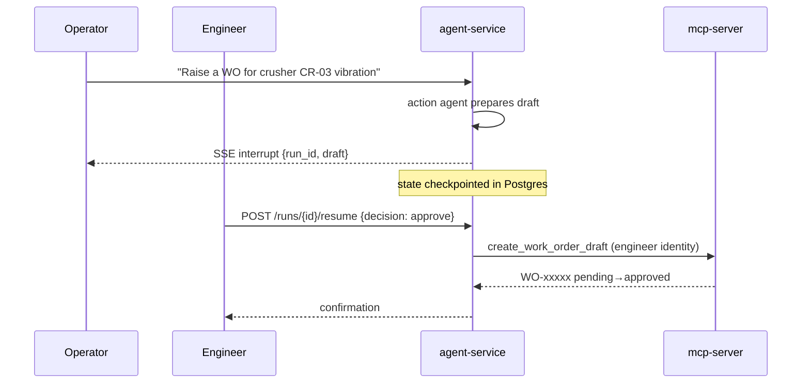

# Architecture

## Component view

## Request flow: chat with a tool call

## HITL flow (action agent)

## Trust boundaries

1. **Internet → gateway**: only public surface. JWT required except `/auth/login`, `/healthz`, JWKS.
2. **gateway → agent-service**: internal network; agent-service re-verifies the JWT (defense in depth).
3. **agent-service → mcp-server**: identity propagated per call; MCP enforces authorization independently of the LLM.
4. **mcp-server → Postgres**: least-privilege DB roles; LLM never produces SQL.
5. **agent-service → LLM**: prompts never contain secrets; outputs are treated as untrusted (validated before tool calls).
