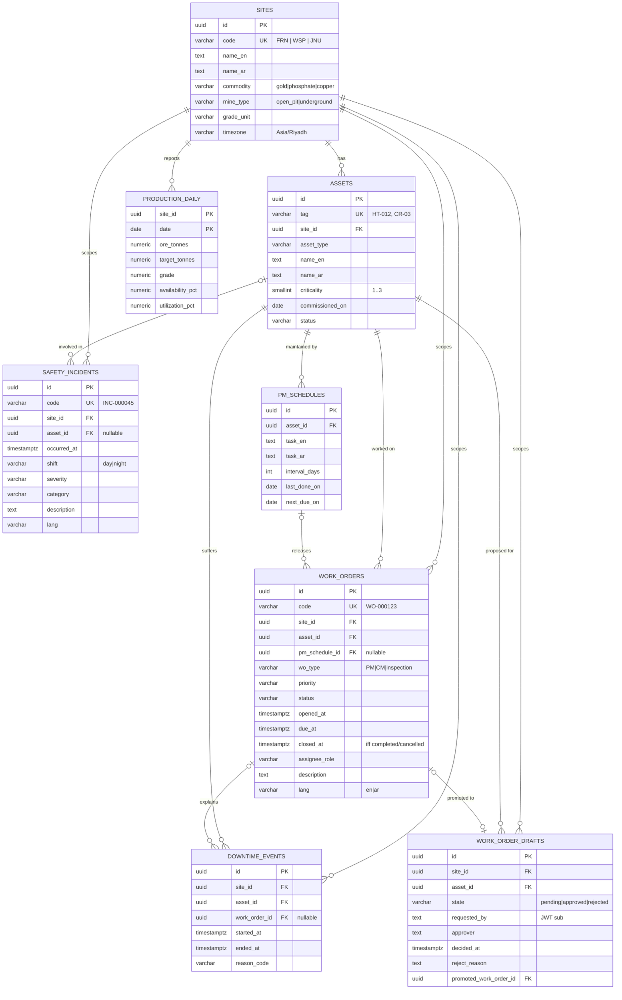

# Data model (M1)

One Postgres 16 instance, four schemas (ADR-0009). M1 creates tables in `ops` plus the
`audit.tool_calls` stub; `auth` (M7) and `agent` (M5) are empty but already have their grants.

Source of truth: `packages/mineops-data/src/mineops_data/models.py` and the Alembic scripts in
`packages/mineops-data/src/mineops_data/migrations/versions/`.

## ER diagram

`audit.tool_calls` (no FKs, append-only): `id, ts, request_id, trace_id, caller_sub,
caller_role, tool, args jsonb, status, error_code, row_count, duration_ms`.

Design choices:
- Vocabularies are `varchar(32)` + named CHECK constraints (`ck_<table>_<vocab>`), not native
  PG enums, so adding a value is a constraint swap in a normal transactional migration.
- `site_id` is denormalised onto work orders, downtime, incidents and drafts: every MCP query
  starts with the caller's site scope, so it must lead the index without a join. Integrity
  tests assert it always matches the asset's site.
- `ON DELETE`: `RESTRICT` for site/asset parents of operational history (never silently lose
  records), `CASCADE` for an asset's PM schedules, `SET NULL` for optional links
  (schedule → WO, WO → downtime, asset → incident, promoted WO).

## Indexes → planned MCP tools

| Index | Serves |
|---|---|
| `production_daily` PK `(site_id, date)` | `get_kpis`, `get_production_vs_target` |
| `work_orders (site_id, status, due_at)` | `list_work_orders`, `list_overdue_work_orders` |
| `work_orders (asset_id, wo_type, opened_at)` | `get_asset` (recent WOs), CM history |
| `downtime_events (site_id, started_at)` | `get_downtime_summary` |
| `downtime_events (asset_id, started_at)` | `get_asset` (downtime) |
| `safety_incidents (site_id, occurred_at)` | `get_incidents` |
| `assets (site_id, asset_type)` | `get_asset`, asset lookups by site |
| `work_order_drafts (site_id, state, created_at)` | HITL pending-approval queue |
| `audit.tool_calls (ts)`, `(caller_sub, ts)` | audit review |

## Roles

| Role | Login | Privileges |
|---|---|---|
| `mineops_owner` | yes | owns all objects, runs migrations/seed (local: also superuser) |
| `app_ro` | yes | `SELECT` on `ops.*` (+ default privileges for future tables); 5 s statement timeout |
| `drafts_rw` | yes | `SELECT` on `ops.assets`, `ops.sites`; `SELECT/INSERT/UPDATE` on `ops.work_order_drafts`; 5 s timeout |
| `agent_rw` | yes | DML + `CREATE` in `agent` (LangGraph checkpointer creates its tables) |
| `gateway_rw` | yes | DML on `auth.*` |
| `audit_writer` | no (group) | `INSERT` only on `audit.tool_calls`; granted to `app_ro` and `drafts_rw` |

Login roles and passwords come from `deploy/compose/initdb/01-roles.sh` (compose) or the
platform (Cloud SQL + Secret Manager). Grants live in migration `0002` so every environment
gets the same privileges. `tests/test_roles.py` proves each boundary with `SET ROLE`.

## Synthetic data

`uv run mineops-data generate --seed 42 --scale medium` (deterministic; fixed end date
2026-09-30, so output never depends on "today").

| Table | medium (seed 42) | small (seed 42) |
|---|---|---|
| sites | 3 | 3 |
| assets | 120 | 18 |
| pm_schedules | 180 | 24 |
| work_orders | 5,512 | 274 |
| downtime_events | 4,824 | 231 |
| production_daily | 1,644 (548 days) | 549 (183 days) |
| safety_incidents | 278 | 103 |

How the numbers are caused, not painted on: each asset has a failure renewal process, so every
failure creates one unplanned downtime event and one linked CM work order. PM work orders are
released from `pm_schedules`, and each completed PM creates a short planned downtime. Daily
availability is driven by that day's unplanned downtime hours at the site, and ore tonnes =
target × seasonality (July low) × availability × noise. About 25% of WO and incident
descriptions are authored in Arabic.

## Injected anomalies (`data/generated/ground_truth.json`)

| ID | Where | What | Detection query (`mineops_data/queries/`) | Expected signal |
|---|---|---|---|---|
| A1 | WSP | Ore ≈ 72% of target for the last 14 days (utilisation also drops) | `production_vs_target` | attainment ≤ 0.85; other sites ≥ 0.92 |
| A2 | FRN, `CR-01` | Repeat main-bearing CM failures every 3–6 days over the last 90 days | `cm_failures_by_asset` | ≥ 10 CMs and ≥ 2× the next crusher |
| A3 | JNU | Every PM due 35–5 days before as_of left open / on hold | `overdue_work_orders_by_site` | ≥ 3× overdue PMs vs any other site |
| A4 | FRN | New night-shift roster 56 days before end; incidents ×3.5 for 28 days, mostly night (fatigue, vehicle interaction) | `incidents_by_week` | weekly rate ≥ 2× the 12-week baseline |

`tests/test_anomalies.py` reads `ground_truth.json` and checks every signal against a real
Postgres loaded with the `small` dataset.
